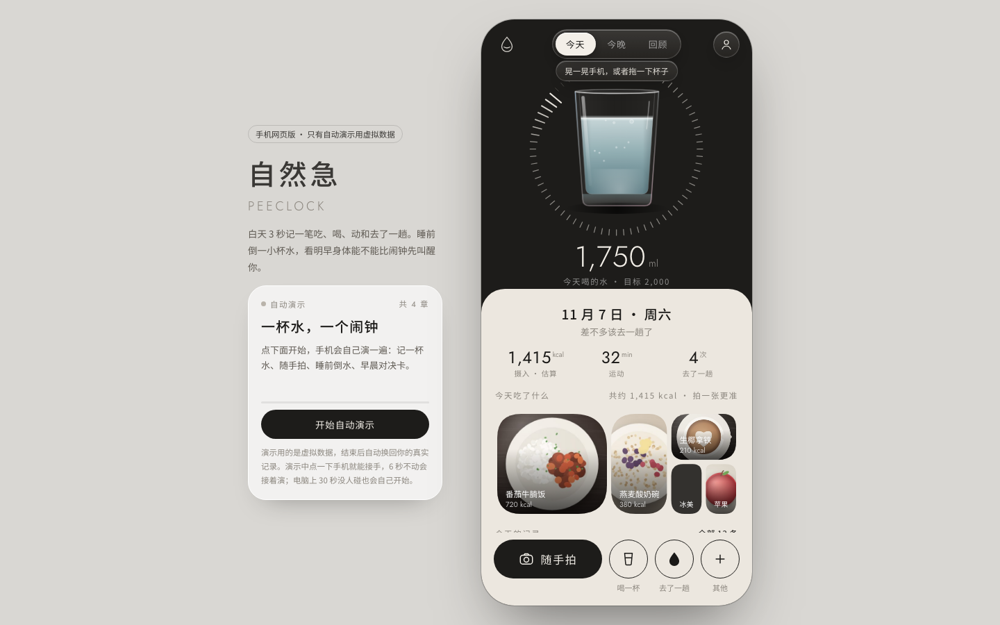
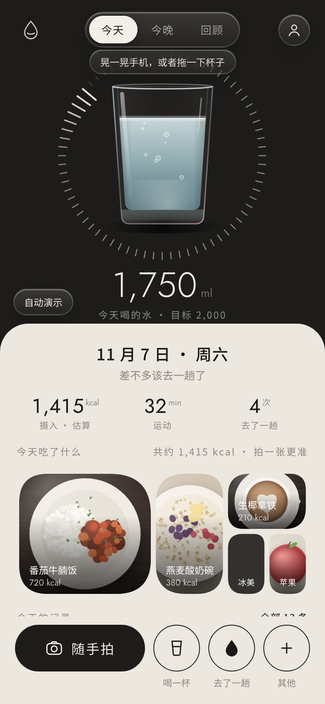
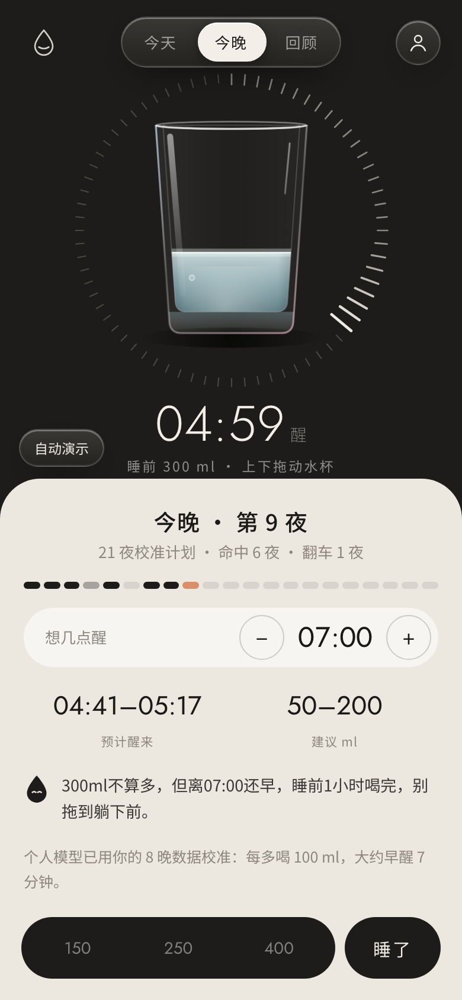
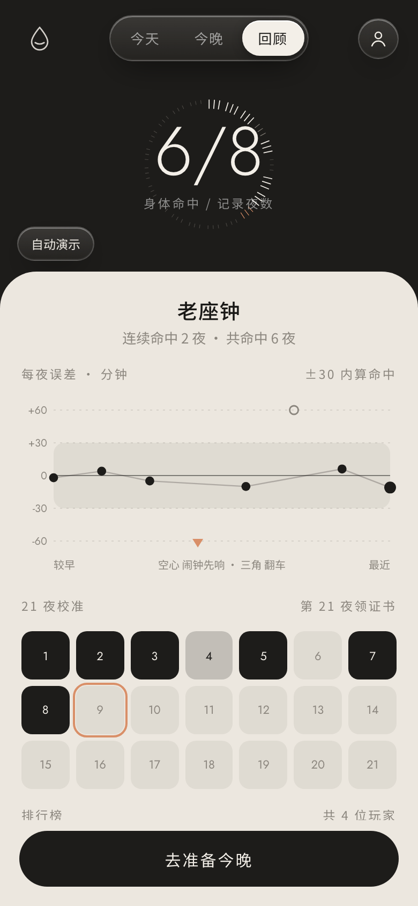
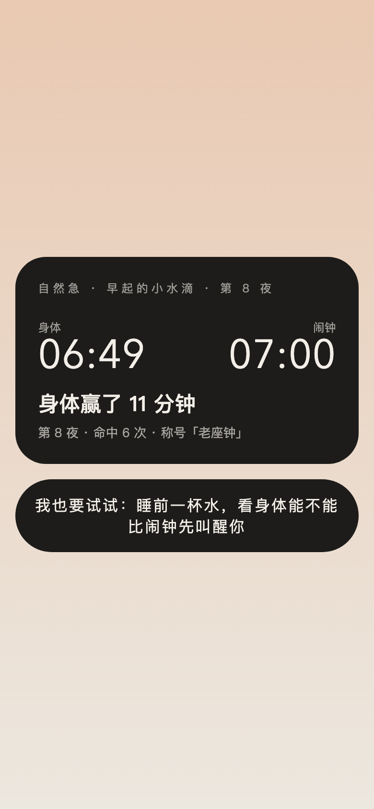

<p align="center">
  
</p>

<h1 align="center">自然急 · Peeclock</h1>

<p align="center"><b>把人类最古老的闹钟，装进手机里。</b><br>
白天 3 秒记完吃喝拉撒，晚上倒一杯水，看身体能不能比闹钟先叫醒你。</p>

<p align="center">
  <a href="https://cx.syal.site"><b>在线体验</b></a> ·
  <a href="docs/REFERENCES.md">科学依据</a> ·
  <a href="docs/preview">预览图集</a>
</p>

<p align="center">
  <code>零依赖</code> <code>Node 18+</code> <code>单文件前端</code> <code>移动端优先</code> <code>可自部署</code>
</p>

---

## 一句话：它不是一个饮水 App

市面上的健康工具基本分三种：**饮水 App** 只管喝进去多少，**排尿日记**只管记录，**智能闹钟**只管睡眠。

「自然急」做了一件很抽象、但一想就通的事：**把喝水、上厕所、醒来放在同一条时间线上**，然后用一个会进化的个人模型，把「睡前这杯水」调成一支**对准你想起床时间的生物闹钟**。

> 在闹钟发明之前，人们就是这么准时起床的：睡前多喝一杯水，到点了，身体自己会把你叫醒。
> 「自然醒」的进阶版，就是「自然急」。

---

## 为什么它既特别、又站得住

| | 别人 | 自然急 |
| --- | --- | --- |
| 记录 | 打开 App → 搜索 → 选食物 → 选份量 | **点一下**（喝一杯 / 去了一趟），或者**拍一张**，3 秒内完成 |
| 预测 | 算法黑箱给一个数字 | **个人模型给基线，大模型只做 ±20 分钟微调**，可解释、稳定 |
| 硬件 | DFree 要贴超声传感器，U-Scan 要买尿检设备 | **不需要任何硬件**，手机浏览器打开就能用 |
| 玩法 | 记录完就结束了 | 每晚生成一张**身体 vs 闹钟**的对决卡，可分享、可一起挑战 |
| 进化 | 手环数据不动 | 每早回答「谁叫醒了你」，**模型重新拟合，越用越懂你** |

三个关键设计，让它同时**有创意、有科学依据、又真的能用**：

1. **「3 秒记录」是硬指标** —— HCI 研究反复证明，记录太麻烦是人们放弃健康追踪的主因（[Epstein et al., CHI 2016](docs/REFERENCES.md)）。所以主操作只有三个按钮。
2. **把「起夜」从麻烦变成资源** —— 泌尿科有一个正式指标「首段无中断睡眠」（FUSP），它和睡眠质量显著相关（[Bliwise et al., 2014](docs/REFERENCES.md)）；25 万可穿戴用户的数据也测到了它（[Int J Clin Pract, 2020](docs/REFERENCES.md)）。医学界一直在想办法把 FUSP 拉长，我们换了个目标：**把它对准你想醒的时间**。
3. **AI 只做它该做的事** —— 识别一句话、认一张照片、写一句点评；预测的主体是每个人自己的统计模型。所以结果**稳定、可解释、不会今天一个说法明天一个说法**。

---

## 看一眼它长什么样

> 截图使用演示 / 示例数据，真实使用中所有记录都来自你自己。

<table>
  <tr>
    <td align="center" width="33%"><br><sub><b>今天</b> · 倾斜手机，杯子里的水会跟着晃</sub></td>
    <td align="center" width="33%"><br><sub><b>今晚</b> · 拖一下杯子，看几点会被叫醒</sub></td>
    <td align="center" width="33%"><br><sub><b>回顾</b> · 误差曲线、21 夜校准、排行榜</sub></td>
  </tr>
</table>

<p align="center">
  
  <br><sub><b>早晨的对决卡</b> · 一张能直接发给朋友的「身体赢了 11 分钟」</sub>
</p>

---

## 它每天怎么用

1. **白天**：喝一杯点一下、去了一趟点一下、吃饭拍一张（大模型认出来、估个热量，份量可调）。
2. **睡前**：上下拖动杯子决定今晚喝多少，表盘实时告诉你「大概几点会被身体叫醒」；到点提醒你定好备用闹钟。
3. **早上**：App 只问一个问题 —— **谁叫醒了你？** 身体 / 闹钟 / 我自己 / 半夜被叫醒。
4. **对决卡**：身体 06:49 vs 闹钟 07:00 —— 身体赢了 11 分钟；可直接分享，朋友点开就能一起挑战。
5. **回顾**：每晚误差、命中次数、称号（老座钟 → 瑞士机芯 → 原子钟级）、21 夜校准计划、排行榜。

---

## 科学依据（全在 [docs/REFERENCES.md](docs/REFERENCES.md)）

| 产品里的说法 | 依据 | 我们怎么用 |
| --- | --- | --- |
| 首段睡眠（入睡→第一次起夜）和睡眠质量相关 | [Bliwise et al., Sleep Medicine 2014](https://www.ncbi.nlm.nih.gov/pmc/articles/PMC4170006/) | 把 FUSP 当作要优化的量 |
| 少起一次夜，睡眠明显变长 | [25 万可穿戴用户研究, Int J Clin Pract 2020](https://www.ncbi.nlm.nih.gov/pmc/articles/PMC7317406/) | 说明「少喝/晚喝一点」的价值 |
| 记录太麻烦会让人放弃 | [Epstein et al., CHI 2016](https://dl.acm.org/doi/abs/10.1145/2858036.2858045) | 3 秒记录硬指标 |
| 大模型能较快估算餐食营养 | [NutriBench, ICLR 2025](https://arxiv.org/abs/2407.12843) | 一句话 / 一张照片 → 结构化记录 |
| 照片估算有误差 | [ChatGPT 餐食照片评估, 2025](https://pubmed.ncbi.nlm.nih.gov/40004936/) | 所有数字标「估算」，可手改 |
| 夜尿、夜间产尿有临床定义 | [ICS Standards 2023](https://www.ics.org/Publications/ICS%20Standards%202023.pdf) | 只做生活参考，不做医学判断 |
| 昼夜节律影响夜间产尿 | [Nocturia 机制综述](https://pubmed.ncbi.nlm.nih.gov/39543359/) | 解释咖啡因 / 酒精的微调 |
| 一个人也能做多夜对照实验 | [StudyMe, Trials 2022](https://www.ncbi.nlm.nih.gov/pmc/articles/PMC9793632/) | 个人模型 = N-of-1 实验 |

**诚实声明**：这些文献支持的是「方向」和「机制」，不是「自然急对每个人都准」。所以产品只给**区间**、不承诺精确，始终保留备用闹钟。

---

## 自进化：为什么它越用越懂你

每个人对水的反应差别很大，所以我们不套一个固定公式，而是每晚重新拟合一个只有两个参数的个人模型：

```text
首段睡眠时长 ≈ a − b × 睡前饮水(ml)
```

- 从文献先验出发：`a = 460 分钟`，`b = 0.075 分钟/ml`（喝 100 ml ≈ 早醒 7.5 分钟）。
- 夜数少时贴近先验，夜数越多越贴近你自己（带先验的最小二乘）。
- 早上的回答决定这一晚的权重：
  - **身体叫醒**：权重 1（完整观测）
  - **半夜被叫醒**：权重 0.6，第二晚建议水量自动少 100 ml
  - **闹钟先响**：权重 0.4（不完整观测），第二晚建议水量多 50 ml
- 今晚的预测 = 个人模型基线 + 大模型根据傍晚咖啡因 / 酒精 / 最近几晚做的 **±20 分钟**微调。

**这是它最「产品」的地方**：AI 不负责预测，只负责把人类语言和个体噪声翻译成一个小修正。预测始终可解释、可复现、不会失控。

---

## 安全与克制（我们主动给自己上的锁）

- 睡前 2 小时饮水 **硬上限 800 ml**，到顶就不能再加。
- **始终保留系统闹钟**，App 反复提醒你定好。
- 常起夜、孕期、有肾脏或心血管疾病、在服利尿药的人，**默认关闭**夜间挑战，只用记录功能。
- 连续「翻车」会提示暂停，不硬撑。
- **不做医学判断，不推荐药物**；所有数字都是生活参考。
- AI 连不上时**如实提示**，绝不用规则或随机数编一个结果。

---

## 技术：一个文件的后端，一个文件的前端

```text
浏览器（单文件 index.html）
  ├─ Canvas 液态玻璃杯 + 陀螺仪（DeviceOrientation）+ 拖动
  ├─ 记录 / 今晚 / 回顾 三视图 + 自动演示（虚拟数据，结束后自动还原）
  └─ fetch /api/*
        │
        ▼
Node 18+（零依赖 server.js）
  ├─ 静态页面 + /api/*
  ├─ 个人模型拟合（带先验最小二乘）
  ├─ 大模型调用（OpenAI /chat/completions 或 Anthropic /messages，工具调用取结构化 JSON）
  ├─ JSON 文件存储（data/db.json，原子写 + SIGTERM 落盘）
  └─ 同源校验 / 按 IP 限流 / 防路径穿越 / 请求体上限
```

- **零依赖**：没有 `npm install`，`node server.js` 就能跑。
- **密钥只在服务端**：前端永远看不到模型 key。
- **数据分层**：当天记录存在手机本地；夜间记录、个人模型、排行榜、分享页存在服务器。
- **演示隔离**：只有点「自动演示」时才用虚拟数据，演示过程不写入任何真实记录。

---

## 快速开始

```bash
# Node 18+
cp .env.example .env      # 填 LLM_BASE / LLM_KEY / LLM_MODEL
node server.js            # http://localhost:8787
```

检查模型是否通：

```bash
curl "http://localhost:8787/api/health?ping=1"
# {"ok":true,...,"llm":{"adj":0,"note":"ok"}}
```

## 部署（当前线上）

- 地址：**https://cx.syal.site**（Cloudflare 代理 + 源站 HTTPS）
- 代码：`/opt/ziranji`，运行用户 `ziranji`，数据 `/opt/ziranji/data/db.json`
- 进程：systemd `ziranji.service`，`Restart=always`，`MemoryHigh=160M / MemoryMax=256M`，只允许写 `data/`
- 反向代理：nginx（HTTP + 源站 443 SNI → `127.0.0.1:9443`），Let's Encrypt 自动续期
- 模型：服务商当前只有 `deepseek-flash`（无视觉模型），所以「随手拍」会走「写个名字 → 文字估热量」的降级路径

```bash
sudo systemctl status ziranji
sudo journalctl -u ziranji -f
curl -s "https://cx.syal.site/api/health?ping=1"
```

## 接口

| 方法 | 路径 | 作用 |
| --- | --- | --- |
| GET | `/api/health?ping=1` | 配置 + 模型连通检查 |
| POST | `/api/parse` | 一句话 → 记录（吃 / 喝 / 动） |
| POST | `/api/photo` | 照片 → 识别食物饮品和热量 |
| POST | `/api/night` | 今晚建议（个人模型 + AI 微调） |
| POST | `/api/morning` | 早晨反馈：存一晚、重新拟合、生成对决卡与分享链接 |
| GET | `/api/me?uid=` | 我的夜间记录、称号、模型参数 |
| POST | `/api/nick` | 排行榜昵称 |
| GET | `/api/board` | 排行榜 |
| GET | `/s/:id` | 对决卡分享页（带 og 标签） |

---

## 局限（不假装）

- 个人差异很大，预测只给区间，不承诺精确。
- 照片估热量有误差；没有视觉模型时会降级为文字估。
- 起夜 / 夜尿涉及健康问题，产品只做生活参考，不替代医生。
- 单机 JSON 存储，适合比赛演示与小规模使用；要上量需要换数据库与队列。

---

## 研究依据

所有引用、链接和「支持什么 / 不支持什么」都整理在 **[docs/REFERENCES.md](docs/REFERENCES.md)**。
宁可少引、不编造；不确定的结论会标成「经验值」或「相关研究」。

---

<p align="center">
  <b>自然急，自然醒的进阶版。</b><br>
  <sub>白天是一个 3 秒就能记完的健康小工具，晚上是一个有医学依据、越用越懂你的身体闹钟。</sub>
</p>
